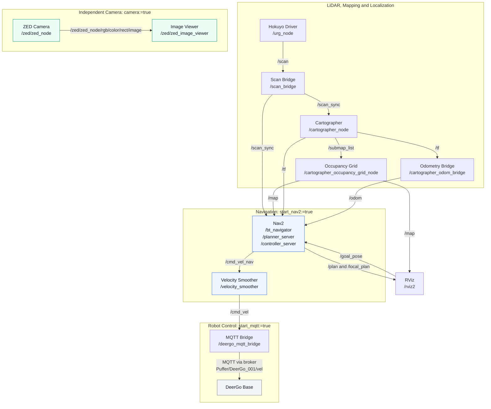
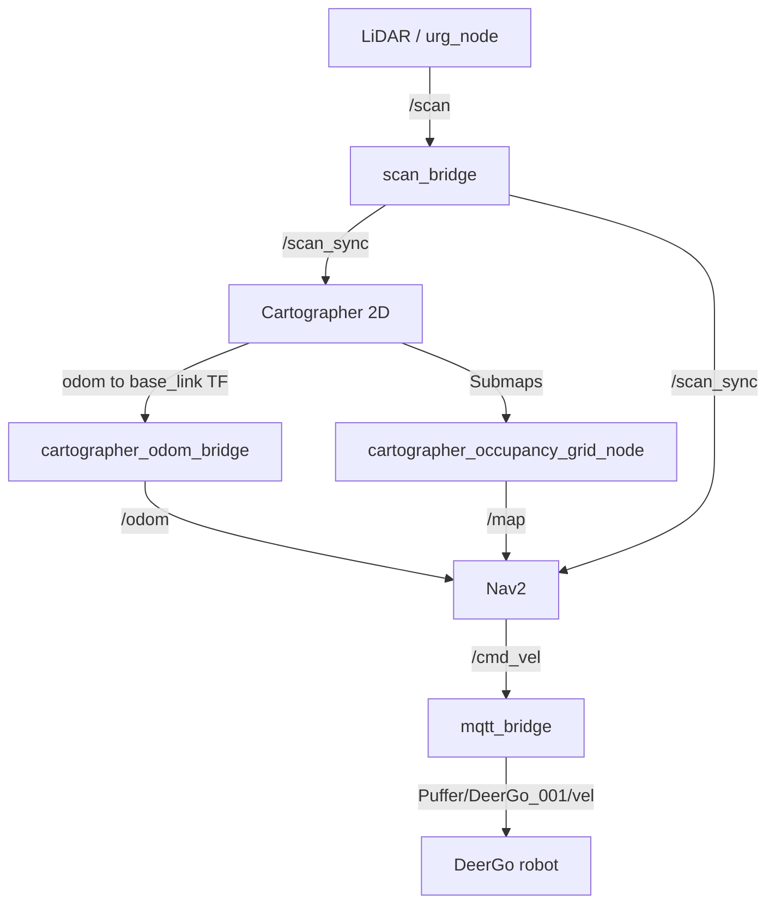

# DeerGo Autonomous Navigation

[繁體中文](README_zh.md) | English

> **Note**: This repository was bootstrapped with the [AGILAB Software Template](https://github.com/AGILAB-NTNU/SoftwareTemplate).

---

## Overview

This project provides a ROS 2 based navigation system for the DeerGo mobile robot.

The system integrates:

- DeerGo MQTT velocity-command communication
- Hokuyo UTM-30LX LiDAR through `urg_node`
- LaserScan EMA preprocessing from `/scan` to `/scan_sync`
- LiDAR-only Cartographer 2D mapping and pure localization
- Cartographer TF-to-odometry bridge publishing `/odom`
- Nav2 autonomous navigation
- RViz2 visualization

The main ROS 2 TF structure is:

```text
map
 │
 ▼
odom
 │
 ▼
base_link
 │
 ▼
laser
```

Cartographer owns both `map -> odom` and `odom -> base_link`.
The odometry bridge publishes `/odom` messages without broadcasting TF.
Wheel/MQTT odometry and IMU data are not used for state estimation.

### ROS 2 System Architecture



---

### LiDAR Navigation Pipeline



`scan_bridge` applies per-beam EMA to valid distances and preserves the original
timestamp, frame, angles, timing metadata, and intensities. Both Cartographer and
Nav2 use this `/scan_sync` stream. Cartographer settings are maintained in
`config/cartographer_mapping.lua` and `config/cartographer_localization.lua`.

---

## Installation

### Prerequisites

System environment:

```text
scripts/ros2_env.sh
```


---

### Setup Instructions

#### 1. Clone the repository

```bash
git clone <repository_url> agilab_deerGO_SLAM

cd agilab_deerGO_SLAM
```

Enter the DeerGo ROS 2 workspace:

```bash
cd src/deeergo_ws
```

All following commands assume that the current directory is:

```text
agilab_deerGO_SLAM/src/deeergo_ws/
```

---

#### 2. Build the ROS 2 workspace

```bash
source /opt/ros/humble/setup.bash

colcon build

source install/setup.bash
```

To rebuild the DeerGo package and its workspace dependencies:

```LiDAR
colcon build \
  --packages-up-to deergo_mqtt_bridge \
  --symlink-install

source install/setup.bash
```

After every rebuild, run `source install/setup.bash` again before launching.
Every additional terminal used for ROS commands must source both
`/opt/ros/humble/setup.bash` and this workspace's `install/setup.bash`.

---

#### 3. Configure Network and ROS 2 Environment

Network and ROS 2 environment setup is integrated into:

```text
scripts/deergo_connect.sh
```

Run:

```bash
source ../../scripts/deergo_connect.sh
```

The script includes:

```bash
sudo ip addr flush dev enp3s0

sudo ip addr add 192.168.158.100/24 dev enp3s0

sudo ip link set enp3s0 up


source /opt/ros/humble/setup.bash

export ROS_DOMAIN_ID=13

export ROS_LOCALHOST_ONLY=0

source install/setup.bash
```

Use `source` instead of directly executing the script so that the ROS 2 environment variables are applied to the current terminal.
The script also starts the Hokuyo driver if the configured device is present
and `urg_node_driver` is not already running. Use the same `ROS_DOMAIN_ID` in
the LiDAR, SLAM, and diagnostic terminals.
For this setup, set `export ROS_DOMAIN_ID=13` in each additional terminal after
sourcing the ROS and workspace environments.

The Hokuyo driver starts with `skip=3`, giving approximately 10 Hz output
from the current 40 Hz sensor. Stop the existing driver before sourcing
the script to apply changed scan settings; a healthy running driver is reused.

---

## Connection Check

Check Ethernet configuration:

```bash
ip addr show enp3s0
```

Check the DeerGo network connection:

```bash
ping -c 4 192.168.158.200
```

Check the MQTT broker:

```bash
nc -zv 192.168.158.200 1883
```

Check the raw LiDAR topic:

```bash
ros2 topic echo /scan --once
```

Check `header.frame_id`, `range_max`, `scan_time`, and `time_increment`.
The current static TF uses `base_link -> laser`, so the scan frame must be
`laser`. If the driver publishes a different frame, align its frame setting
with the static TF before starting Cartographer.
The current mounting correction uses `roll = pi` (180 degrees) to align the
LiDAR's left/right direction with the robot frame. The offset is
`x = 1.0 m`, `y = 0`, `z = 0`; `/scan_sync` preserves the incoming scan geometry
and timestamps while applying EMA to distances.
`base_link` is at the rear drive axle / rotation center. In `nav2_params.yaml`,
the body extends 1.05 m forward and 0.10 m behind this origin, with 0.30 m on
each side. Both costmaps use this footprint. The local window is 12 x 12 m;
LiDAR obstacles are marked within 5 m and cleared by rays up to 6 m.

---

## Project Structure

```text
agilab_deerGO_SLAM/
├── assets/                     # README figures and diagrams
├── scripts/
│   ├── ros2_env.sh              # Ubuntu / ROS 2 dependency setup
│   └── deergo_connect.sh        # Network, ROS 2, and Hokuyo setup
│
├── src/
│   └── deeergo_ws/              # ROS 2 workspace (three e characters)
│       ├── maps/                # Cartographer .pbstream and occupancy exports
│       ├── src/
│       │   └── deergo_mqtt_bridge/
│       │       ├── config/      # Cartographer .lua / Nav2 .yaml
│       │       ├── launch/      # ROS 2 launch files
│       │       ├── rviz/        # deergo_cartographer.rviz
│       │       └── deergo_mqtt_bridge/ # ROS 2 Python nodes
│       ├── build/               # ROS 2 build files
│       ├── install/             # ROS 2 installed workspace
│       └── log/                 # ROS 2 build logs
├── README.md
└── README_zh.md
```

---

## Usage

### First-Time Mapping

Start Cartographer 2D mapping with Nav2 disabled:

```bash
ros2 launch deergo_mqtt_bridge slam_rviz.launch.py \
  load_map:=false \
  start_nav2:=false
```

The launch file starts:

```text
mqtt_bridge
scan_bridge
base_link -> laser static TF
cartographer_node (cartographer_mapping.lua)
cartographer_occupancy_grid_node
cartographer_odom_bridge
RViz2
ZED camera + independent OpenCV image window (only with camera:=true, when installed)
```

The Hokuyo driver must be running separately and publishing `/scan`; the SLAM
launch does not start it. Nav2 only starts when `start_nav2:=true`.
First verify `/scan_sync`, `/map`, `/odom`, and the TF chain with Nav2 disabled.

For LiDAR-only mapping while the robot / MQTT broker is disconnected, disable
the MQTT bridge explicitly:

```bash
export ROS_DOMAIN_ID=13
ros2 launch deergo_mqtt_bridge slam_rviz.launch.py \
  load_map:=false \
  start_nav2:=false \
  start_mqtt:=false
```

`start_mqtt` defaults to `true`. Match `ROS_DOMAIN_ID` to the running LiDAR
driver. If `/scan` stops arriving after a network change, check the driver
before enabling Nav2; a running driver process alone does not confirm that
scan messages are arriving. An Ethernet `NO-CARRIER` state means the physical
link is unavailable, and the MQTT broker cannot be reached through that link.

### ZED Camera Window

Add `camera:=true` to `slam_rviz.launch.py` to start the ZED camera and a
separate **DeerGo ZED Camera** window. The camera is disabled by default.
Install camera support with
`scripts/ros2_env.sh`; on a PC that already has ROS 2 installed, run
`DEERGO_ZED_ONLY=1 bash scripts/ros2_env.sh` from the repository root instead
of reinstalling the full environment. The installer uses official ZED SDK
5.5.0, CUDA Toolkit 12.8 (without replacing the NVIDIA driver), wrapper
`v5.5.0`, and the system OpenCV / `cv_bridge` packages. It requires sudo and
builds the camera packages and `deergo_mqtt_bridge` in this repository's workspace.
It also applies the repository's SDK reopen cleanup patch so a failed USB open
can retry without getting stuck on `INVALID_FUNCTION_CALL`.
For the original ZED (`2b03:f580`), a device-specific USB access rule lets launch
reset an idle camera before opening the SDK stream, without runtime sudo.
The preflight skips cameras already in use and does not reset other USB devices.

RGB, left/right and depth topics stay under `/zed/`. The viewer discovers
the actual rectified RGB topic and displays only the latest frame. Camera
localization, mapping and dynamic TF are disabled; camera-internal TF is
confined to `/zed/tf` and `/zed/tf_static`. Camera data is not connected to
Cartographer, Nav2, LiDAR, MQTT, or robot control. The camera captures at 720p /
30 FPS and targets up to 30 FPS ROS publication at the native 1280x720 resolution.
RGB uses BGR8 instead of BGRA8, reducing bytes per RGB frame by 25% without
changing color values. `NEURAL_LIGHT` uses SDK 5.5 CUDA Graph optimization when
available; actual FPS still depends on GPU, CPU and camera connection health.
Point clouds remain disabled; CPU/GPU/USB resources are shared with the host.

The dedicated metric depth stream is already enabled:

| Topic | Type / content |
|---|---|
| `/zed/zed_node/depth/depth_registered` | `sensor_msgs/msg/Image`, `32FC1`, meters |
| `/zed/zed_node/depth/camera_info` | `sensor_msgs/msg/CameraInfo`, depth intrinsics |

The wrapper publishes depth frames when a subscriber connects. Subscribe
directly to this stream with `KEEP_LAST`, depth **1**, `BEST_EFFORT` and
`VOLATILE` to keep only the newest available frame in your processing node.
No additional relay or copy of the full-resolution depth image is needed.
Invalid depth values can be NaN or infinity; check `isfinite` before processing.
RGB and depth use separate topics; use matching timestamps when combining them.

```bash
ros2 topic echo /zed/zed_node/depth/depth_registered \
  --once --field encoding --qos-reliability best_effort
```

Closing the camera window (or pressing Q / Esc) only stops the viewer.
Missing camera packages skip the camera branch without stopping SLAM; without
a desktop display, the camera publishes topics without opening a window.
Omit `camera` or set `camera:=false` to leave the camera disabled.
`zed_camera_model` defaults to the first-generation `zed` model.


---

### Localization With an Existing Map

If Cartographer serialized state already exists in:

```text
maps/deergo_map.pbstream
```

start localization mode with:

```bash
ros2 launch deergo_mqtt_bridge slam_rviz.launch.py \
  load_map:=true \
  start_nav2:=false \
  start_mqtt:=true
```

`start_mqtt:=true` explicitly enables the MQTT velocity bridge (the default).
Use `start_mqtt:=false` when the robot / MQTT broker is disconnected.

This loads the PBStream as frozen state and starts a new trajectory using
`cartographer_localization.lua`. Cartographer's occupancy-grid node remains
the `/map` publisher.

After pure localization and `/odom` have been verified, restart with Nav2:

```bash
ros2 launch deergo_mqtt_bridge slam_rviz.launch.py \
  load_map:=true \
  start_nav2:=true \
  start_mqtt:=true
```

Run mapping, saving, and localization from the same workspace directory.
`maps/` is relative to the working directory in which Cartographer is launched.

### Nav2 Scan Receiver Queues

The local voxel layer uses `deergo_nav2_plugins::QueueVoxelLayer`; the global
obstacle layer uses `deergo_nav2_plugins::QueueObstacleLayer`. Both inherit the
original Nav2 processing and set **DDS receive depth and TF MessageFilter
capacity to 10** in the supplied YAML files. The system Nav2 libraries remain unchanged.

Set `scan_queue_size` under the voxel and obstacle layer sections in the Nav2
YAML files. This is an initialization setting: restart Nav2 after editing it.
Queue size limits message count, not elapsed latency; when full, the oldest
waiting messages are discarded. TF tolerances and controller and costmap
frequencies are unchanged. The connection script starts the Hokuyo with `skip=3`
for approximately 10 Hz output; an already running driver retains its current setting.

At 40 Hz a new scan arrives every 25 ms. A TF filter capacity of 1 can repeatedly
discard scans if the required transforms take longer than this to become available.
The upstream layers also wait for TF at the scan timestamp plus 50 ms; reducing
the queue does not shorten this wait and can prevent live obstacles from updating.

Build with `colcon build --packages-up-to deergo_mqtt_bridge`, then source
`install/setup.bash`. The normal launch command stays the same. To restore the
upstream layers, change the two plugin names back to
`nav2_costmap_2d::VoxelLayer` and `nav2_costmap_2d::ObstacleLayer` and remove
their `scan_queue_size` entries.

### save Navigation map points

Keep the normal SLAM/Nav2 launch command. In another terminal, source the ROS
and workspace environments and use the same domain (`ROS_DOMAIN_ID=13` here):

```bash
source /opt/ros/humble/setup.bash
source install/setup.bash
export ROS_DOMAIN_ID=13

# Park at each location, then save its map position and heading.
ros2 run deergo_mqtt_bridge location save home
ros2 run deergo_mqtt_bridge location save station_a
ros2 run deergo_mqtt_bridge location save station_b

ros2 run deergo_mqtt_bridge location list
ros2 run deergo_mqtt_bridge location go station_a
```

Points persist in `src/deeergo_ws/maps/deergo_locations.yaml` relative to the
repository root, independently of the terminal's working directory.
Saving an existing name updates that point and preserves the
others. `go` sends a `NavigateToPose` goal directly to Nav2 and exits after Nav2
accepts it; acceptance does not mean arrival. Selecting another point with `go`
updates the navigation target. No extra service or background node is needed.
Only `go` sends a navigation goal; `save` and `list` do not move the robot.

Use points with the same map they were recorded on; resave them after remapping.
For separate map files, append `--file /absolute/path/points.yaml` to each command.

---

## DeerGo Motion Control

### Enable Velocity Control

Before sending Nav2 velocity commands to DeerGo:

```bash
mosquitto_pub \
  -h 192.168.158.200 \
  -p 1883 \
  -t 'Puffer/DeerGo_001/motion_enable' \
  -m '0'
```

With `start_nav2:=true` and Nav2 active, use the RViz2 goal tool to select a
navigation target. Starting Nav2 alone does not send a navigation goal.

---

### Disable Velocity Control

Disable DeerGo motion:

```bash
mosquitto_pub \
  -h 192.168.158.200 \
  -p 1883 \
  -t 'Puffer/DeerGo_001/motion_disable' \
  -m '0'
```

---

## Map Management

### Save Cartographer State

Keep the mapping launch running. In another terminal, enter the same workspace
directory from the directory containing `agilab_deerGO_SLAM`, load its
environment, and create the map directory:

```bash
cd agilab_deerGO_SLAM/src/deeergo_ws
source /opt/ros/humble/setup.bash
source install/setup.bash

# deergo_connect.sh uses domain 13; match your mapping terminal if different.
export ROS_DOMAIN_ID=13
mkdir -p maps
```

Save the current Cartographer state:

```bash
ros2 service call /write_state \
  cartographer_ros_msgs/srv/WriteState \
  "{filename: 'maps/deergo_map.pbstream', include_unfinished_submaps: true}"
```

Output:

```text
maps/deergo_map.pbstream
```

`status.code: 0` indicates success. `include_unfinished_submaps: true` saves a
snapshot of the active state, so mapping can continue. This PBStream is the
file required by `load_map:=true`.

---

### Export the Occupancy Map

Optionally export Cartographer's `/map` occupancy grid for inspection or backup:

```bash
ros2 run nav2_map_server map_saver_cli -f maps/deergo_map
```

Output:

```text
maps/deergo_map.yaml
maps/deergo_map.pgm
```

The two save commands produce different map formats:

| Files | Purpose |
| --- | --- |
| `deergo_map.pbstream` | Cartographer serialized SLAM state for pure localization |
| `deergo_map.yaml` / `deergo_map.pgm` | Exported 2D occupancy map |

The current workflow uses these terminal commands. The main launch does not
start `map_manager` or a lifecycle-managed `map_saver_server`, so
`/save_deergo_map` is not available through that launch. RViz's **Save Config**
saves display settings rather than map data.

---

### Stop Mapping and Load the Saved State

Wait for `/write_state` to report success before stopping the mapping launch
with **Ctrl+C**. Then start localization from the same workspace directory:

```bash
ros2 launch deergo_mqtt_bridge slam_rviz.launch.py \
  load_map:=true \
  start_nav2:=false \
  start_mqtt:=true
```

---

## Debugging

### Check ROS 2 Topics

In each diagnostic terminal, load ROS and match the driver's domain:

```bash
source /opt/ros/humble/setup.bash
source install/setup.bash
export ROS_DOMAIN_ID=13
export ROS_LOCALHOST_ONLY=0
ros2 topic list --no-daemon
```

---

### Check Odometry

```bash
ros2 topic echo /odom
ros2 topic hz /odom
```

`/odom` is derived from Cartographer's `odom -> base_link` TF, not MQTT or wheel
odometry. Check `header.frame_id: odom`, `child_frame_id: base_link`, and finite
twist values before enabling Nav2.

---

### Check Raw LiDAR

```bash
ros2 topic echo /scan --once --qos-reliability best_effort
ros2 topic hz /scan
```

The expected scan frame is `laser`. Point count, angular resolution and scan
frequency depend on the connected LiDAR; the earlier 683-point / 10 Hz reading
does not describe every replacement Hokuyo. `scan_bridge` does not assume a
fixed point count.

---

### Check Synchronized LiDAR

`/scan_sync` applies a causal first-order EMA independently to each laser beam:
`filtered = alpha * current + (1 - alpha) * previous_filtered`.
The first sample passes through. Invalid returns (`NaN`, `inf`, or out-of-range
distances), geometry changes, non-increasing timestamps and long scan gaps reset
the relevant history. Raw-to-raw distance changes above the threshold pass through
immediately and restart that beam's history. Original timestamps and all fields
other than `ranges` are preserved; each incoming scan produces one output.

| `/scan_bridge` parameter | Default | Meaning |
| --- | --- | --- |
| `ema_enabled` | `true` | Enable EMA; `false` forwards the raw message |
| `ema_alpha` | `0.8` | Current sample weight, in `(0, 1]`; smaller values smooth more |
| `ema_jump_threshold_m` | `0.03` | Reset a beam when consecutive raw distances differ by more than this |
| `ema_reset_gap_s` | `0.2` | Reset all beams after a timestamp gap longer than this |

Parameters can be changed while the node runs. Accepted changes take effect on the
next scan and reset the filter history. Changes made with `ros2 param set` last
until the node restarts; startup defaults are declared in `scan_bridge.py`.

```bash
ros2 param get /scan_bridge ema_alpha
ros2 param set /scan_bridge ema_alpha 0.8
ros2 param set /scan_bridge ema_enabled false
ros2 param set /scan_bridge ema_enabled true
```

At 10 Hz, alpha=0.8 has approximately 25 ms of low-frequency filter group delay
when no reset occurs. This is smoothing lag, not measured ROS queue latency.
Gradual real distance changes are also smoothed; the 3 cm bypass only handles
larger jumps. Compare `/scan` and `/scan_sync` during stationary and moving tests.

```bash
ros2 topic echo /scan_sync
```

Check the LiDAR publishing frequency:

```bash
ros2 topic hz /scan_sync
```

---

### Check Nav2 Velocity

```bash
ros2 topic echo /cmd_vel
```

---

### Check Cartographer and RViz

```bash
ros2 topic echo /submap_list --once
ros2 topic echo /map --once
```

In `rviz/deergo_cartographer.rviz`:

| Display topic | Meaning |
| --- | --- |
| `/map` | Occupancy map; darker cells indicate higher occupancy probability |
| `/scan_sync` | EMA-preprocessed Hokuyo scan |
| `/scan_matched_points2` | Cartographer's aligned scan points, shown in red |
| `/local_costmap/published_footprint` | Nav2 robot footprint, shown in red when its costmap is active |

To inspect the occupancy map alone, disable the LaserScan and Scan matched
points displays. The RViz fixed frame is `map`.

---

### Check MQTT Velocity

```bash
mosquitto_sub \
  -h 192.168.158.200 \
  -p 1883 \
  -t 'Puffer/DeerGo_001/vel' \
  -v
```

---

### Check TF

Check:

```text
map -> odom
```

```bash
ros2 run tf2_ros tf2_echo map odom
```

Check:

```text
odom -> base_link
```

```bash
ros2 run tf2_ros tf2_echo odom base_link
```

Check:

```text
base_link -> laser
```

```bash
ros2 run tf2_ros tf2_echo base_link laser
```

---

### Check Nav2 Local Costmap

Check the local costmap publishing frequency:

```bash
ros2 topic hz /local_costmap/costmap
```

Check lifecycle states:

```bash
ros2 lifecycle get /local_costmap/local_costmap

ros2 lifecycle get /controller_server
```

The normal state is:

```text
active [3]
```

---

## Quick Start

### Prepare the Environment and Check LiDAR

Start from the directory containing the cloned `agilab_deerGO_SLAM` repository:

```bash
cd agilab_deerGO_SLAM/src/deeergo_ws
source ../../scripts/deergo_connect.sh
source install/setup.bash
export ROS_DOMAIN_ID=13
export ROS_LOCALHOST_ONLY=0

ros2 topic list --no-daemon
ros2 topic echo /scan --once --qos-reliability best_effort
```

After changing source code or configuration, rebuild before launching:

```bash
colcon build --packages-up-to deergo_mqtt_bridge --symlink-install
source install/setup.bash
```

In every additional terminal, start from the directory containing
`agilab_deerGO_SLAM` and run:

```bash
cd agilab_deerGO_SLAM/src/deeergo_ws
source /opt/ros/humble/setup.bash
source install/setup.bash
export ROS_DOMAIN_ID=13
export ROS_LOCALHOST_ONLY=0
```

### Restart LiDAR if `/scan` Is Missing

Check the existing driver:

```bash
ls -l /dev/serial/by-id/
pgrep -a -x urg_node_driver
tail -n 30 /tmp/deergo_hokuyo.log
```

Stop it with **Ctrl+C**, or use `kill -INT <PID>` for the identified background
process. Wait for it to exit, then start only the LiDAR:

```bash
ros2 run urg_node urg_node_driver \
  --ros-args \
  --params-file /opt/ros/humble/share/urg_node/launch/urg_node_serial.yaml \
  -p serial_port:=/dev/serial/by-id/usb-Hokuyo_Data_Flex_for_USB_URG-Series_USB_Driver-if00 \
  -p laser_frame_id:=laser \
  -p angle_min:=-2.09439510239 \
  -p angle_max:=2.09439510239 \
  -p skip:=3
```

Keep this terminal open. In another prepared terminal, check:

```bash
ros2 topic echo /scan --once --qos-reliability best_effort
```

### Mapping

```bash
ros2 launch deergo_mqtt_bridge slam_rviz.launch.py \
  load_map:=false \
  start_nav2:=false \
  start_mqtt:=true
```

For USB-only mapping without the robot's MQTT connection, add
`start_mqtt:=false`.

### Save Cartographer State

In another prepared terminal, while mapping is running:

```bash
mkdir -p maps
ros2 service call /write_state \
  cartographer_ros_msgs/srv/WriteState \
  "{filename: 'maps/deergo_map.pbstream', include_unfinished_submaps: true}"
```

Wait for success before stopping the mapping launch with **Ctrl+C**.

### Localization

```bash
ros2 launch deergo_mqtt_bridge slam_rviz.launch.py \
  load_map:=true \
  start_nav2:=true \
  start_mqtt:=true
```

### Enable the ZED Camera (Optional)

The camera is disabled by default. Add `camera:=true` to either the mapping
or localization command to start it together with its image window:

```bash
ros2 launch deergo_mqtt_bridge slam_rviz.launch.py \
  load_map:=true \
  start_nav2:=true \
  start_mqtt:=true \
  camera:=true
```

Use `camera:=false` or omit the argument to keep the camera disabled.
ROS 2 launch arguments use `:=`, so write `camera:=true`.

### Enable Robot Motion

```bash
mosquitto_pub \
  -h 192.168.158.200 \
  -p 1883 \
  -t 'Puffer/DeerGo_001/motion_enable' \
  -m '0'
```

### Stop Robot Motion

```bash
mosquitto_pub \
  -h 192.168.158.200 \
  -p 1883 \
  -t 'Puffer/DeerGo_001/motion_disable' \
  -m '0'
```

---

## Contributing

This project follows the unified AGILAB development workflow.

Before contributing, please refer to the [AGILAB Software Lab Guide](https://agilab-ntnu.github.io/AGILAB_Software_Lab_Guide/en/contributing/) for branching strategies and coding standards.


---

## License

This project is licensed under the Apache License 2.0.
