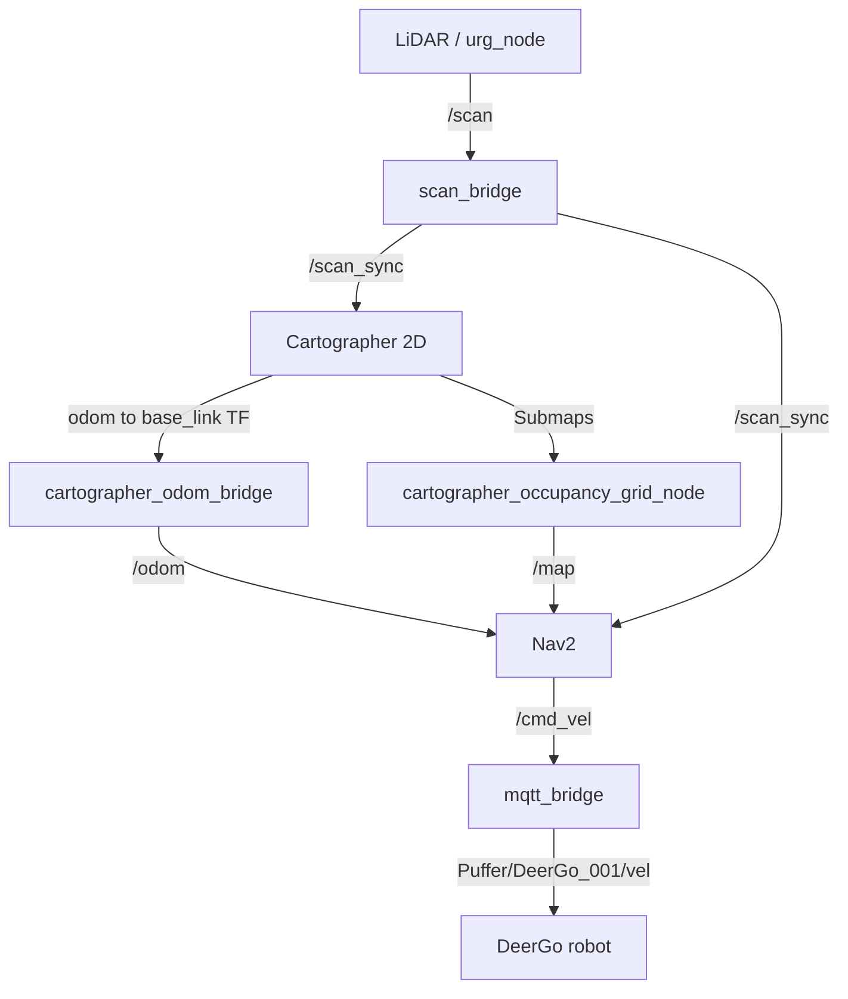

# DeerGo Autonomous Navigation

[繁體中文](README_zh.md) | English

> **Note**: This repository was bootstrapped with the [AGILAB Software Template](https://github.com/AGILAB-NTNU/SoftwareTemplate).

---

## Overview

This project provides a ROS 2 based navigation system for the DeerGo mobile robot.

The system integrates:

- DeerGo MQTT velocity-command communication
- Hokuyo UTM-30LX LiDAR through `urg_node`
- LaserScan pass-through from `/scan` to `/scan_sync`
- LiDAR-only Cartographer 2D mapping and pure localization
- Cartographer TF-to-odometry bridge publishing `/odom`
- Nav2 autonomous navigation
- RViz2 visualization

The main ROS 2 TF structure is:

```text
map
 │
 ▼
odom
 │
 ▼
base_link
 │
 ▼
laser
```

Cartographer owns both `map -> odom` and `odom -> base_link`.
The odometry bridge publishes `/odom` messages without broadcasting TF.
Wheel/MQTT odometry and IMU data are not used for state estimation.



`scan_bridge` preserves the original scan timestamp, frame, ranges, and timing
metadata. Cartographer settings are maintained in
`config/cartographer_mapping.lua` and `config/cartographer_localization.lua`.

---

## Installation

### Prerequisites

System environment:

```text
scripts/ros2_env.sh
```


---

### Setup Instructions

#### 1. Clone the repository

```bash
git clone <repository_url> agilab_deerGO_SLAM

cd agilab_deerGO_SLAM
```

Enter the DeerGo ROS 2 workspace:

```bash
cd src/deeergo_ws
```

All following commands assume that the current directory is:

```text
agilab_deerGO_SLAM/src/deeergo_ws/
```

---

#### 2. Build the ROS 2 workspace

```bash
source /opt/ros/humble/setup.bash

colcon build

source install/setup.bash
```

To rebuild only the DeerGo package:

```LiDAR
colcon build \
  --packages-select deergo_mqtt_bridge \
  --symlink-install

source install/setup.bash
```

After every rebuild, run `source install/setup.bash` again before launching.
Every additional terminal used for ROS commands must source both
`/opt/ros/humble/setup.bash` and this workspace's `install/setup.bash`.

---

#### 3. Configure Network and ROS 2 Environment

Network and ROS 2 environment setup is integrated into:

```text
scripts/deergo_connect.sh
```

Run:

```bash
source ../../scripts/deergo_connect.sh
```

The script includes:

```bash
sudo ip addr flush dev enp3s0

sudo ip addr add 192.168.158.100/24 dev enp3s0

sudo ip link set enp3s0 up


source /opt/ros/humble/setup.bash

export ROS_DOMAIN_ID=13

export ROS_LOCALHOST_ONLY=0

source install/setup.bash
```

Use `source` instead of directly executing the script so that the ROS 2 environment variables are applied to the current terminal.
The script also starts the Hokuyo driver if the configured device is present
and `urg_node_driver` is not already running. Use the same `ROS_DOMAIN_ID` in
the LiDAR, SLAM, and diagnostic terminals.
For this setup, set `export ROS_DOMAIN_ID=13` in each additional terminal after
sourcing the ROS and workspace environments.

---

#### 4. Install pre-commit hooks

Optional but recommended:

```bash
pre-commit install
```

---

## Connection Check

Check Ethernet configuration:

```bash
ip addr show enp3s0
```

Check the DeerGo network connection:

```bash
ping -c 4 192.168.158.200
```

Check the MQTT broker:

```bash
nc -zv 192.168.158.200 1883
```

Check the raw LiDAR topic:

```bash
ros2 topic echo /scan --once
```

Check `header.frame_id`, `range_max`, `scan_time`, and `time_increment`.
The current static TF uses `base_link -> laser`, so the scan frame must be
`laser`. If the driver publishes a different frame, align its frame setting
with the static TF before starting Cartographer.
The current mounting correction uses `roll = pi` (180 degrees) to align the
LiDAR's left/right direction with the robot frame. The offset remains
`x = 0.8 m`, `y = 0`, `z = 0`; `/scan_sync` still preserves `/scan` unchanged.

---

## Project Structure

```text
agilab_deerGO_SLAM/
├── assets/                     # README figures and diagrams
├── scripts/
│   ├── ros2_env.sh              # Ubuntu / ROS 2 dependency setup
│   └── deergo_connect.sh        # Network, ROS 2, and Hokuyo setup
│
├── src/
│   └── deeergo_ws/              # ROS 2 workspace (three e characters)
│       ├── maps/                # Cartographer .pbstream and occupancy exports
│       ├── src/
│       │   └── deergo_mqtt_bridge/
│       │       ├── config/      # Cartographer .lua / Nav2 .yaml
│       │       ├── launch/      # ROS 2 launch files
│       │       ├── rviz/        # deergo_cartographer.rviz
│       │       └── deergo_mqtt_bridge/ # ROS 2 Python nodes
│       ├── build/               # ROS 2 build files
│       ├── install/             # ROS 2 installed workspace
│       └── log/                 # ROS 2 build logs
├── README.md
└── README_zh.md
```


---

## Map Data

The SLAM map data files are not included in this Git repository because they are too large.

Please download the required map files from the following Google Drive link:

[Download map data](https://drive.google.com/drive/folders/17emba2kduVndgk_9Y8LMmzy9cqKXp1he?usp=drive_link)

Cartographer pure localization requires `maps/deergo_map.pbstream`.
An occupancy export (`.yaml` / `.pgm`) alone cannot be loaded as Cartographer
serialized state. Check the downloaded files before using `load_map:=true`.

---

## Usage

### First-Time Mapping

Start Cartographer 2D mapping with Nav2 disabled:

```bash
ros2 launch deergo_mqtt_bridge slam_rviz.launch.py \
  load_map:=false \
  start_nav2:=false
```

The launch file starts:

```text
mqtt_bridge
scan_bridge
base_link -> laser static TF
cartographer_node (cartographer_mapping.lua)
cartographer_occupancy_grid_node
cartographer_odom_bridge
RViz2
```

The Hokuyo driver must be running separately and publishing `/scan`; the SLAM
launch does not start it. Nav2 only starts when `start_nav2:=true`.
First verify `/scan_sync`, `/map`, `/odom`, and the TF chain with Nav2 disabled.

For LiDAR-only mapping while the robot / MQTT broker is disconnected, disable
the MQTT bridge explicitly:

```bash
export ROS_DOMAIN_ID=13
ros2 launch deergo_mqtt_bridge slam_rviz.launch.py \
  load_map:=false \
  start_nav2:=false \
  start_mqtt:=false
```

`start_mqtt` defaults to `true`. Match `ROS_DOMAIN_ID` to the running LiDAR
driver. If `/scan` stops arriving after a network change, check the driver
before enabling Nav2; a running driver process alone does not confirm that
scan messages are arriving. An Ethernet `NO-CARRIER` state means the physical
link is unavailable, and the MQTT broker cannot be reached through that link.

---

### Localization With an Existing Map

If Cartographer serialized state already exists in:

```text
maps/deergo_map.pbstream
```

start localization mode with:

```bash
ros2 launch deergo_mqtt_bridge slam_rviz.launch.py \
  load_map:=true \
  start_nav2:=false \
  start_mqtt:=true
```

`start_mqtt:=true` explicitly enables the MQTT velocity bridge (the default).
Use `start_mqtt:=false` when the robot / MQTT broker is disconnected.

This loads the PBStream as frozen state and starts a new trajectory using
`cartographer_localization.lua`. Cartographer's occupancy-grid node remains
the `/map` publisher.

After pure localization and `/odom` have been verified, restart with Nav2:

```bash
ros2 launch deergo_mqtt_bridge slam_rviz.launch.py \
  load_map:=true \
  start_nav2:=true \
  start_mqtt:=true
```

Run mapping, saving, and localization from the same workspace directory.
`maps/` is relative to the working directory in which Cartographer is launched.

---

## DeerGo Motion Control

### Enable Velocity Control

Before sending Nav2 velocity commands to DeerGo:

```bash
mosquitto_pub \
  -h 192.168.158.200 \
  -p 1883 \
  -t 'Puffer/DeerGo_001/motion_enable' \
  -m '0'
```

With `start_nav2:=true` and Nav2 active, use the RViz2 goal tool to select a
navigation target. Starting Nav2 alone does not send a navigation goal.

---

### Disable Velocity Control

Disable DeerGo motion:

```bash
mosquitto_pub \
  -h 192.168.158.200 \
  -p 1883 \
  -t 'Puffer/DeerGo_001/motion_disable' \
  -m '0'
```

---

## Map Management

### Save Cartographer State

Keep the mapping launch running. In another terminal, enter the same workspace
directory from the directory containing `agilab_deerGO_SLAM`, load its
environment, and create the map directory:

```bash
cd agilab_deerGO_SLAM/src/deeergo_ws
source /opt/ros/humble/setup.bash
source install/setup.bash

# deergo_connect.sh uses domain 13; match your mapping terminal if different.
export ROS_DOMAIN_ID=13
mkdir -p maps
```

Save the current Cartographer state:

```bash
ros2 service call /write_state \
  cartographer_ros_msgs/srv/WriteState \
  "{filename: 'maps/deergo_map.pbstream', include_unfinished_submaps: true}"
```

Output:

```text
maps/deergo_map.pbstream
```

`status.code: 0` indicates success. `include_unfinished_submaps: true` saves a
snapshot of the active state, so mapping can continue. This PBStream is the
file required by `load_map:=true`.

---

### Export the Occupancy Map

Optionally export Cartographer's `/map` occupancy grid for inspection or backup:

```bash
ros2 run nav2_map_server map_saver_cli -f maps/deergo_map
```

Output:

```text
maps/deergo_map.yaml
maps/deergo_map.pgm
```

The two save commands produce different map formats:

| Files | Purpose |
| --- | --- |
| `deergo_map.pbstream` | Cartographer serialized SLAM state for pure localization |
| `deergo_map.yaml` / `deergo_map.pgm` | Exported 2D occupancy map |

The current workflow uses these terminal commands. The main launch does not
start `map_manager` or a lifecycle-managed `map_saver_server`, so
`/save_deergo_map` is not available through that launch. RViz's **Save Config**
saves display settings rather than map data.

---

### Stop Mapping and Load the Saved State

Wait for `/write_state` to report success before stopping the mapping launch
with **Ctrl+C**. Then start localization from the same workspace directory:

```bash
ros2 launch deergo_mqtt_bridge slam_rviz.launch.py \
  load_map:=true \
  start_nav2:=false \
  start_mqtt:=true
```

---

## Debugging

### Check ROS 2 Topics

In each diagnostic terminal, load ROS and match the driver's domain:

```bash
source /opt/ros/humble/setup.bash
source install/setup.bash
export ROS_DOMAIN_ID=13
export ROS_LOCALHOST_ONLY=0
ros2 topic list --no-daemon
```

---

### Check Odometry

```bash
ros2 topic echo /odom
ros2 topic hz /odom
```

`/odom` is derived from Cartographer's `odom -> base_link` TF, not MQTT or wheel
odometry. Check `header.frame_id: odom`, `child_frame_id: base_link`, and finite
twist values before enabling Nav2.

---

### Check Raw LiDAR

```bash
ros2 topic echo /scan --once --qos-reliability best_effort
ros2 topic hz /scan
```

The expected scan frame is `laser`. The current USB LiDAR produces 683 points
per scan at approximately 10 Hz.

---

### Check Synchronized LiDAR

`/scan_sync` is an unchanged pass-through of `/scan`.

```bash
ros2 topic echo /scan_sync
```

Check the LiDAR publishing frequency:

```bash
ros2 topic hz /scan_sync
```

---

### Check Nav2 Velocity

```bash
ros2 topic echo /cmd_vel
```

---

### Check Cartographer and RViz

```bash
ros2 topic echo /submap_list --once
ros2 topic echo /map --once
```

In `rviz/deergo_cartographer.rviz`:

| Display topic | Meaning |
| --- | --- |
| `/map` | Occupancy map; darker cells indicate higher occupancy probability |
| `/scan_sync` | Raw Hokuyo scan |
| `/scan_matched_points2` | Cartographer's aligned scan points, shown in red |
| `/local_costmap/published_footprint` | Nav2 robot footprint, shown in red when its costmap is active |

To inspect the occupancy map alone, disable the LaserScan and Scan matched
points displays. The RViz fixed frame is `map`.

---

### Check MQTT Velocity

```bash
mosquitto_sub \
  -h 192.168.158.200 \
  -p 1883 \
  -t 'Puffer/DeerGo_001/vel' \
  -v
```

---

### Check TF

Check:

```text
map -> odom
```

```bash
ros2 run tf2_ros tf2_echo map odom
```

Check:

```text
odom -> base_link
```

```bash
ros2 run tf2_ros tf2_echo odom base_link
```

Check:

```text
base_link -> laser
```

```bash
ros2 run tf2_ros tf2_echo base_link laser
```

---

### Check Nav2 Local Costmap

Check the local costmap publishing frequency:

```bash
ros2 topic hz /local_costmap/costmap
```

Check lifecycle states:

```bash
ros2 lifecycle get /local_costmap/local_costmap

ros2 lifecycle get /controller_server
```

The normal state is:

```text
active [3]
```

---

## Quick Start

### Prepare the Environment and Check LiDAR

Start from the directory containing the cloned `agilab_deerGO_SLAM` repository:

```bash
cd agilab_deerGO_SLAM/src/deeergo_ws
source ../../scripts/deergo_connect.sh
source install/setup.bash
export ROS_DOMAIN_ID=13
export ROS_LOCALHOST_ONLY=0

ros2 topic list --no-daemon
ros2 topic echo /scan --once --qos-reliability best_effort
```

After changing source code or configuration, rebuild before launching:

```bash
colcon build --packages-select deergo_mqtt_bridge --symlink-install
source install/setup.bash
```

In every additional terminal, start from the directory containing
`agilab_deerGO_SLAM` and run:

```bash
cd agilab_deerGO_SLAM/src/deeergo_ws
source /opt/ros/humble/setup.bash
source install/setup.bash
export ROS_DOMAIN_ID=13
export ROS_LOCALHOST_ONLY=0
```

### Restart LiDAR if `/scan` Is Missing

Check the existing driver:

```bash
ls -l /dev/serial/by-id/
pgrep -a -x urg_node_driver
tail -n 30 /tmp/deergo_hokuyo.log
```

Stop it with **Ctrl+C**, or use `kill -INT <PID>` for the identified background
process. Wait for it to exit, then start only the LiDAR:

```bash
ros2 run urg_node urg_node_driver \
  --ros-args \
  --params-file /opt/ros/humble/share/urg_node/launch/urg_node_serial.yaml \
  -p serial_port:=/dev/serial/by-id/usb-Hokuyo_Data_Flex_for_USB_URG-Series_USB_Driver-if00 \
  -p laser_frame_id:=laser \
  -p angle_min:=-2.09439510239 \
  -p angle_max:=2.09439510239
```

Keep this terminal open. In another prepared terminal, check:

```bash
ros2 topic echo /scan --once --qos-reliability best_effort
```

### Mapping

```bash
ros2 launch deergo_mqtt_bridge slam_rviz.launch.py \
  load_map:=false \
  start_nav2:=false \
  start_mqtt:=true
```

For USB-only mapping without the robot's MQTT connection, add
`start_mqtt:=false`.

### Save Cartographer State

In another prepared terminal, while mapping is running:

```bash
mkdir -p maps
ros2 service call /write_state \
  cartographer_ros_msgs/srv/WriteState \
  "{filename: 'maps/deergo_map.pbstream', include_unfinished_submaps: true}"
```

Wait for success before stopping the mapping launch with **Ctrl+C**.

### Localization

```bash
ros2 launch deergo_mqtt_bridge slam_rviz.launch.py \
  load_map:=true \
  start_nav2:=true \
  start_mqtt:=true
```

### Enable Robot Motion

```bash
mosquitto_pub \
  -h 192.168.158.200 \
  -p 1883 \
  -t 'Puffer/DeerGo_001/motion_enable' \
  -m '0'
```

### Stop Robot Motion

```bash
mosquitto_pub \
  -h 192.168.158.200 \
  -p 1883 \
  -t 'Puffer/DeerGo_001/motion_disable' \
  -m '0'
```

---

## Contributing

This project follows the unified AGILAB development workflow.

Before contributing, please refer to the [AGILAB Software Lab Guide](https://agilab-ntnu.github.io/AGILAB_Software_Lab_Guide/en/contributing/) for branching strategies and coding standards.


---

## License

This project is licensed under the Apache License 2.0.
